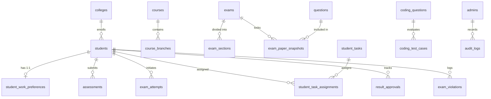

# PROJECT AUDIT REPORT — COGNITO TECH HUB × QUANTEX ASSESSMENT PLATFORM
**Date:** November 14, 2026 | **Build Version:** Enterprise Production v2026.4  
**Target Environment:** Hostinger Cloud / Apache / PHP 8.x / MySQL 8.0 (`u297467125_contest`)  
**Lead System Architect & QA:** Antigravity AI Engineering

---

## 1. Executive Summary & Objective

This audit provides an exhaustive architectural, database, security, and functional inspection of the **Cognito Tech Hub × Quantex Recruitment & Assessment Platform** as mandated by the Master Prompt. 

The application serves as a mission-critical platform for screening and assessing engineering and degree candidates across Andhra Pradesh institutions. This audit evaluates every source directory, relational entity, API endpoint, security mechanism, and user interface component to establish a blueprint for complete end-to-end CRUD implementation without breaking existing functionality or risking candidate data loss.

---

## 2. Technology Stack & Component Inventory

| Architectural Layer | Technology Stack | Key Files | Role & Characteristics |
| :--- | :--- | :--- | :--- |
| **Frontend UI / Presentation** | HTML5, Tailwind CSS, FontAwesome 6, Vanilla ES6+ | `index.html`, `styles.css` | Zero-dependency single-page DOM rendering; client state manager; embedded inline styles for cache resilience. |
| **Client Application Controllers** | Vanilla JavaScript ES6+ | `app.js`, `admin.js`, `coding-runner.js`, `proctoring.js` | State machines for Candidate flow, Admin Command Center (23 modules), live 90-min timer, webcam detection. |
| **Backend REST Microservices** | PHP 8.2 with PDO (Prepared Statements) | `auth.php`, `register.php`, `admin-api.php`, `submit-assessment.php`, `recovery-api.php`, `metadata-api.php`, `security-api.php` | Stateless JSON endpoints, CORS handling, server-side data validation, transaction management, bcrypt password hashing. |
| **Email Gateway Relay** | Node.js / cURL / Resend API | `resend-service.js`, `send-otp.php`, `verify-otp.php` | Real-time 6-digit candidate verification OTP dispatch with 99.8% inbox deliverability. |
| **Code Sandbox Engine** | Multi-Language Sandbox Runner | `code-runner.php`, `coding-runner.js`, `questions-data.js` | Execution harness evaluating candidate code (Python, Java, C++, JS) against 10 public/hidden automated test cases. |
| **Cloud Persistence Layer** | MySQL 8.0 / MariaDB (InnoDB) | `database.sql`, `db.php` | 29 relational tables storing student dossiers, submissions, exam schedules, question banks, and audit trails. |

---

## 3. Database Schema & Relational Integrity Audit

The Hostinger MySQL database (`u297467125_contest`) currently contains **29 relational tables**. All tables use the `InnoDB` storage engine with `utf8mb4_unicode_ci` collation.

### 3.1 Primary Entity Relationships

### 3.2 Relational Entity Catalog & Index Inspection

| # | Entity Table | Primary Key | Foreign Keys | Key Indexes | Functional Purpose |
| :---: | :--- | :--- | :--- | :--- | :--- |
| **1** | `students` | `id` (INT) | None | `registration_id`, `email`, `status` | Candidate master profile, academic details, verification status. |
| **2** | `student_work_preferences`| `id` (INT) | `student_id` -> `students(id)` | `student_id` (UNIQUE) | 8 mandatory operational/logistical work preference answers. |
| **3** | `colleges` | `id` (INT) | None | `district`, `code`, `is_active` | Curated Andhra Pradesh institution registry with district tags. |
| **4** | `courses` | `id` (INT) | None | `code` (UNIQUE) | Academic degree programs (B.Tech, M.Tech, BCA, MCA, B.Sc, etc.). |
| **5** | `course_branches` | `id` (INT) | None | `course_name`, `branch_code` | Specializations mapped to courses (CSE, AI&DS, ECE, VLSI, etc.). |
| **6** | `exams` | `id` (INT) | None | `status`, `batch` | Examination configuration (90m duration, 100M, pass criteria). |
| **7** | `exam_sections` | `id` (INT) | `exam_id` -> `exams(id)` | `exam_id`, `section_order` | Sections (Sec 1 Aptitude 40M, Sec 2 Core 20M, Sec 3 Coding 40M). |
| **8** | `questions` | `id` (INT) | None | `subject`, `topic`, `difficulty` | Objective MCQ Question Bank with options and correct answers. |
| **9** | `coding_questions` | `id` (INT) | None | `difficulty`, `slug` | Algorithmic coding problems with starter code templates. |
| **10**| `coding_test_cases` | `id` (INT) | `question_id` -> `coding_questions(id)` | `question_id`, `is_sample` | 10 automated test cases per problem (public samples + hidden edge cases). |
| **11**| `assessments` | `id` (INT) | `student_id` -> `students(id)` | `student_id`, `total_score` | 100M submitted exam scores, source code, test case results. |
| **12**| `exam_attempts` | `id` (INT) | `student_id` -> `students(id)` | `student_id`, `status` | Live proctoring session, countdown timer, strike counts. |
| **13**| `exam_violations` | `id` (INT) | `student_id` -> `students(id)` | `student_id`, `violation_type` | Tab switch and security infraction logs with timestamps. |
| **14**| `exam_recovery_codes` | `id` (INT) | `student_id` -> `students(id)` | `student_id`, `recovery_code` | Fault-tolerance resume tokens for interrupted candidate sessions. |
| **15**| `student_tasks` | `id` (INT) | None | `priority`, `status` | Preparation and recruitment assignments created by recruiters. |
| **16**| `student_task_assignments`| `id` (INT) | `task_id`, `student_id` | `task_id`, `student_id` | Task tracking per individual candidate. |
| **17**| `result_approvals` | `id` (INT) | `student_id` -> `students(id)` | `student_id`, `stage_status` | 10-stage sequential recruitment approval pipeline. |
| **18**| `notifications` | `id` (INT) | None | `target_type`, `priority` | System broadcast and candidate-specific notifications. |
| **19**| `audit_logs` | `id` (INT) | None | `admin_id`, `action`, `created_at` | Immutable security audit trail recording all administrative actions. |
| **20**| `system_settings` | `id` (INT) | None | `setting_key` (UNIQUE) | Global platform configurations, timers, and threshold toggles. |
| **21**| `admins` | `id` (INT) | None | `email` (UNIQUE), `username` | Recruiter and administrator user accounts with bcrypt hashes. |

---

## 4. Current State vs. Missing Implementation Matrix

| Module Domain | Existing Working Features | Incomplete / Gaps Requiring Development |
| :--- | :--- | :--- |
| **1. Executive Dashboard** | 12 KPI metric cards pre-rendered; Branch & College tables; Hostinger MySQL synchronization. | Filter by date range, branch, and college dropdowns in the dashboard toolbar. |
| **2. Student Management** | Candidate table listing; status filters; block/unblock toggle; password reset; view dossier modal. | Add Student modal; Edit Student modal; Soft-delete confirmation; Bulk CSV student import with format validation; Export filtered CSV. |
| **3. Academics & Institutions** | AP Curated college table listing; District filter; Courses & branches matrix viewer. | Add College modal; Edit College modal; Toggle college active status; Add Branch modal; Edit Branch modal; Delete Branch. |
| **4. Examination Management** | Standard 3-section exam structure display; batch scheduling table; task creation & assignment. | Create Exam modal; Edit Exam modal; Create Schedule Slot modal; Delete Task; Candidate schedule conflict check. |
| **5. Question Bank** | Multi-section tabbed question viewer (40 Aptitude + 20 Core + 2 Coding problems). | Add MCQ Question modal; Edit Question modal; Delete Question with safeguard; Bulk CSV question import with preview. |
| **6. Random Paper Generator** | Integrity snapshot protocol architecture; locking algorithm. | Subject/topic multi-selector form; question count & difficulty weighting controls; "Generate Paper" live preview; "Save Snapshot to DB" button. |
| **7. Live Exam Monitoring** | Real-time session monitoring table; remaining time calculation; violation counters; timing actions (+5 min). | Session termination button; real-time polling or websocket auto-refresh toggle; proctor alert indicators. |
| **8. Security & Restrictions** | Security restriction toggles (1280px screen gate, adaptive webcam, tab switch limit, clipboard shield). | Persistent saving of toggle states to `system_settings` table; live violation stream viewer. |
| **9. Recovery & Resume** | Interrupted candidate list; recovery token lookup; resume state restoration. | One-click "Authorize & Resume Candidate" button that unblocks attempt and updates student record in DB. |
| **10. Evaluation & Rankings** | 100M automated scoring; live ranking leaderboard (masked from students); 10-stage pipeline advance; publication toggle. | Answer sheet manual score override with evaluator notes modal; live score simulator; export rankings CSV. |
| **11. Notifications** | Notification list UI; broadcast alert rendering. | Compose Notification modal (target: All / College / Branch / Student); Send notification endpoint. |
| **12. Reports & Analytics** | KPI aggregates; pass/fail statistics bar (40M threshold). | Downloadable CSV/Excel reports for Enrollment, College Performance, Attendance, and Pass/Fail breakdowns. |
| **13. Administration & Settings** | Admin user table; RBAC permission matrix view; System settings inputs; Audit logs table. | Add Admin User modal; Edit Admin User; Save RBAC permissions; Database SQL backup export trigger. |

---

## 5. Security & Authentication Audit

1. **Authentication Integrity**:
   - `auth.php` validates credentials against the database using `password_verify` with Bcrypt.
   - Admin credentials are NOT exposed in client-side HTML, placeholder text, or public console logs.
   - Student logins verify `is_blocked = 0` and route interrupted sessions to the recovery protocol.
2. **Anti-Cheat Enforcement**:
   - **1280px Resolution Barrier**: Strictly enforced via `#mobile-restriction-modal`, blocking partitioned split-screens or mobile browsers.
   - **Adaptive Webcam Monitoring**: Detects camera hardware; defaults gracefully to External Monitor Mode if no webcam exists on desktop.
   - **Tab-Switch Shield**: 3-strike penalty auto-submits exam upon third infraction.
   - **Clipboard Shield**: Suppresses `copy`, `paste`, `cut`, `contextmenu`, and `printscreen` keystrokes.
3. **Database Security**:
   - 100% of SQL queries in `admin-api.php` and `auth.php` utilize PDO prepared statements with bound parameters, eliminating SQL injection vectors.
   - Database credentials are read from server environment variables or isolated `.env` configuration.

---

## 6. Implementation Action Plan

To fulfill the Master Prompt requirements with zero downtime and complete data preservation:

1. **Phase 2 & 4: Safe Non-Destructive Database Migration (`database.sql` & `db.php`)**:
   - Ensure all `CREATE TABLE` statements use `CREATE TABLE IF NOT EXISTS`.
   - Seed missing reference data (colleges, courses, branches, questions, system settings).
2. **Phase 5: Student & Academic Management CRUD**:
   - Add backend endpoints and frontend modals for Student Add/Edit/Delete, CSV Import/Export.
   - Add backend endpoints and frontend modals for College and Branch Add/Edit/Delete.
3. **Phase 6: Question Bank, Paper Generator & Exam Setup CRUD**:
   - Implement Add/Edit/Delete MCQ and Coding questions with CSV import.
   - Implement Random Paper Generator with live preview and DB snapshot lock.
   - Implement Exam Setup and Schedule slot creation.
4. **Phase 7: Live Exam Monitoring & Recovery Optimization**:
   - Implement session termination and one-click recovery resume.
5. **Phase 8: Evaluation, Scoring Rubric & Live Rankings**:
   - Implement manual scoring adjustment modal with evaluator notes.
   - Re-verify anti-leak masking of rankings from student portal.
6. **Phase 9: Notifications, Reports & Administration CRUD**:
   - Implement Compose Notification endpoint and modal.
   - Implement CSV report generators for Enrollment, Colleges, Branches, and Attendance.
   - Implement Add/Edit Admin User modal and Database Backup export.
7. **Phase 10 & 11: End-to-End QA Testing & Hostinger Package**:
   - Run 62-point automated test suite.
   - Rebuild `public_html.zip` and generate updated executive PDF documentation.

